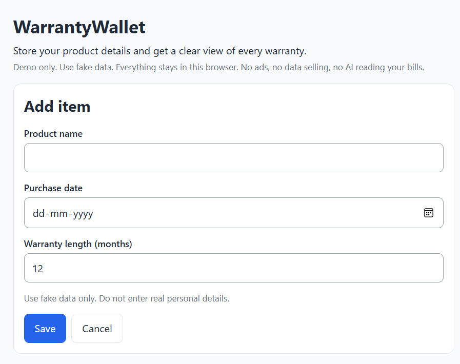
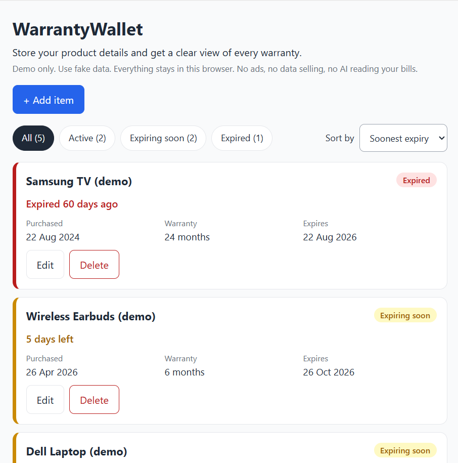
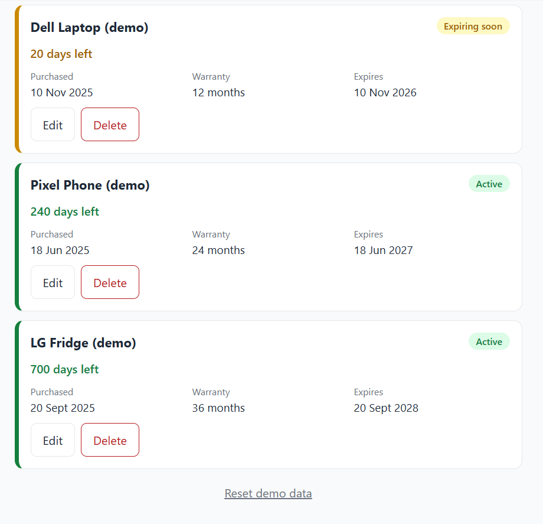
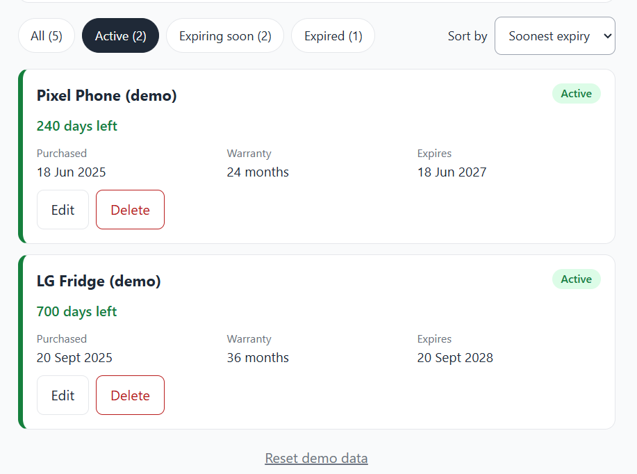
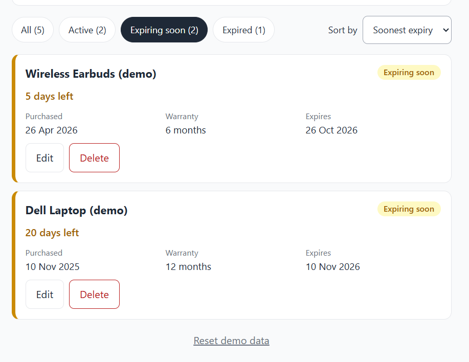
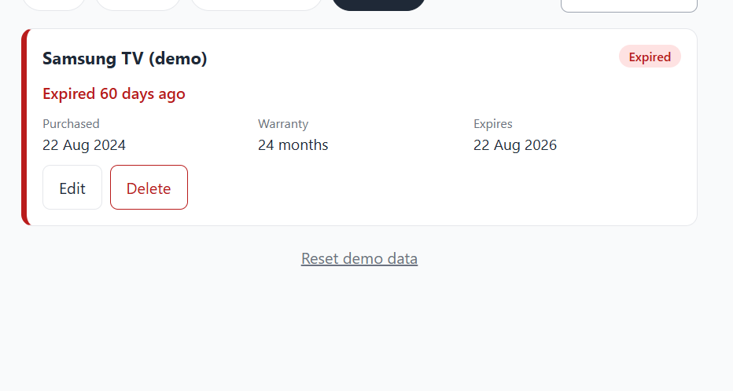

# WarrantyWallet

A simple tracker for product warranties. Add what you bought and see which warranties are active, expiring soon, or expired.

## Features

- Green, yellow and red status for every warranty
- Add, edit and delete items
- Filter by status and sort by expiry
- Saves in your browser, with no account needed

## Screenshots














## Run it locally

```bash
npm install
npm run dev
```

Then open http://127.0.0.1:5173

## Tech stack

React, Vite, plain CSS, and the browser's localStorage.

## How it works

**Expiry date** = purchase date + warranty length in months. If the purchase day doesn't exist in the target month, the last day of that month is used (31 Jan + 1 month = 28 Feb, or 29 Feb in a leap year).

**Status**, based on whole days left:

| Days left | Status |
| --- | --- |
| More than 30 | Green: Active |
| 0 to 30 | Yellow: Expiring soon |
| Below 0 | Red: Expired |

All date maths uses UTC calendar dates, so results never shift with the user's time zone or daylight saving.

## Testing

```bash
npm test
```

26 unit tests cover expiry maths (leap years, month ends, year boundaries), status thresholds, input validation, and the storage layer, including corrupted, hostile and unavailable storage.

## Author

**Your Name**: [GitHub profile](https://github.com/NandaniSingh27)
